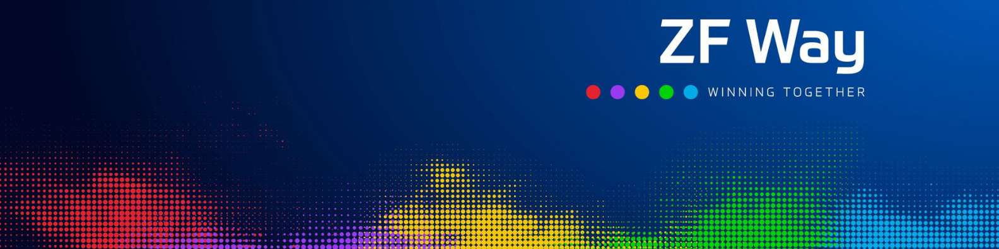
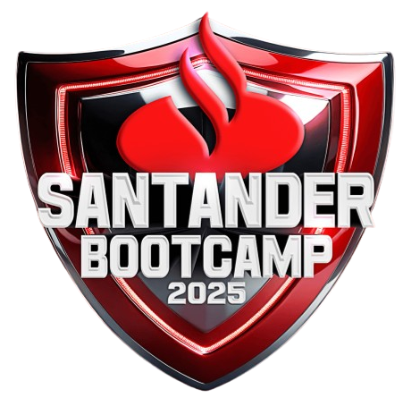
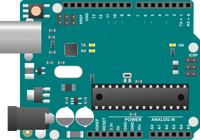
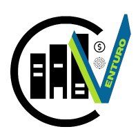

---

**PT-BR** - 
Eu sou estagiário de TI no time de BRM (Gestão de Relacionamento com o Negócio) da ZF Group, estudante de Engenharia de Software com formação técnica em desenvolvimento de sistemas e eletroeletrônica. Além disso, sou bolsista pelo ICETI (Instituto Cesumar de Tecnologia e Inovação) e violinista pela Orquestra Sinfônica da Escola Heitor Villa-Lobos, Americana-SP.

Atualmente, trabalho no desenvolvimento de aplicações corporativas de ETL (extração de dados) e BAPI (API de negócios) dentro do SAP (utilizando ABAP) em conjunto das áreas do negócio, através do mapeamento de processos com BPMN e técnicas de elicitação/especificação de requisitos. Possuo experiência acadêmia em desenvolvimento de sistemas web com HTML/CSS/JS, React.js e API REST para gerenciar chamadas da aplicação em bancos de dados como MySQL Workbench. Também possuo experiência em desenvolvimento de aplicações mobile com React Native e na construção de aplicações desktops com GUI construída como Webview. E também, conhecimentos em gerenciamento de VMs pela GCP (Google Cloud-Platform).

Por fim, procuro conhcer os processos dentro da corporação e desenvolver meu trabalho baseado nelas em conjunto de metodologias como 5S, Scrum e Kanban. Entretanto, busco estar sempre atualizado sobre novas tendências e outros setores que aplicam a Engenharia de Software como os setores de Pesquisa e Inovação, Aeroespacial, Robótica, Financeiro, Agronomia, etc.

---

**EN** -
I'm an IT Intern in BRM at ZF Group, Software Engineering student with technical degree in systems development and electroelectronic. Futhermore, I have worked on scholarship project for ICETI and I'm a violinist at Symphony Orchestra of School Heitor Villa-Lobos from Americana-SP, Brazil.

Currently, I work with ETL (Extract-Loading-Transform) and BAPI (Business API) enterprise applications development in SAP (ABAP) with business areas to map process with BPMN and requirements elicitation/specification methods. I have academic experience in web development with HTML/CSS/JS and API RESTs with MySQL Workbench. Also, I have experience in mobile devlopment with React Native and build desktop applications with GUI as Webview. And also, I have knowledge on VMs management at GCP (Google Cloud Platform).

Finally, I try to know the process within corporation and develop my work based on it with agile methodologies like 5S, Scrun and Kanban. But, I always have searched about new tendencies and others sectors than apply the Software Engineering as R&D, Aerospace, Robotics, Finance, Agronomy, etc.

---

## 🚀 Minhas estatísticas no GitHub

  

  

---

## 🛠️ Tecnologias que utilizo

  
   
   
   
  
  
  
  
   
  
   
  

---

## 🌟 Destaques

<table align="center"> 
<tr>
<td align="center" width="33%">   <strong>Ugrow Social App</strong>  <em>Projeto Universitário em Desenvolvimento</em>  <a href="https://github.com/Ugrow-Social-App">Ver Organização →</a></td>

<td align="center" width="33%">   <strong>Santander 2025 - Front-End</strong>  <em>Bootcamp Realizado</em>  <a href="https://github.com/GuilhermeVeigaPedromilo/Bootcamp_Santander_2025_Front_End.git">Ver repositório →</a></td> <td align="center" width="33%">   <strong>CLP Educacional</strong>  <em>Projeto Realizado</em>  <a href="https://github.com/GuilhermeVeigaPedromilo/CLP_SENAI">Ver repositório →</a></td>

</tr>
<tr>
<td align="center" width="33%">   <strong>DIO Campus Expert | Turma 12</strong>  <em>Programa Realizado</em>  <a href="https://www.dio.me/users/guipedromilo">Ver Perfil na DIO →</a></td>

<td align="center" width="33%">   <strong>Heineken - IA com Copilot</strong>  <em>Bootcamp Realizado</em>  <a href="https://github.com/GuilhermeVeigaPedromilo/Desafios-de-projeto-Bootcamp-HeinekenIntelig-nciaArtificialAplicadaADadosComCopilot.git">Ver repositório →</a></td><td align="center" width="33%">   <strong>Suzano Python Developer</strong>  <em>Bootcamp Realizado</em>  <a href="https://github.com/GuilhermeVeigaPedromilo/Suzano---Python-Developer.git">Ver repositório →</a></td>

</tr>
<tr> 
<td align="center" width="33%">   <strong>Venturo ERP</strong>  <em>Projeto Realizado</em>  <a href="https://github.com/Venturo-s-Dev-Team">Ver no GitHub →</a> </td>

<td align="center" width="33%">   <strong>PixelBank</strong>  <em>Protótipo de app bancário</em>  <a href="https://github.com/GuilhermeVeigaPedromilo/_Project_Pixel_Prophets_.git">Ver no GitHub →</a> </td>

<td align="center" width="33%">   <strong>SP-Medical Group</strong>  <em>Site clínico - Primeiro projeto</em>  <a href="https://github.com/GuilhermeVeigaPedromilo/SP-Medical-Group-SENAI">Ver no GitHub →</a> </td>
</tr> </table>

---

## 📫 Perfis e contatos

<!-- - **Portfólio Profissional:** [Guilherme Veiga Pedromilo](https://guilhermeveigapedromilo.github.io/GuilhermeVeigaPedromilo/) -->
- **Lattes:** https://lattes.cnpq.br/1361768583170521
- **LinkedIn:** [Guilherme Veiga Pedromilo](https://www.linkedin.com/in/guilhermeveigapedromilo/)
- **DIO public profile:** [Guilherme Veiga Pedromilo](https://www.dio.me/users/guipedromilo)
- **E-mail:** guipedromilo@gmail.com
